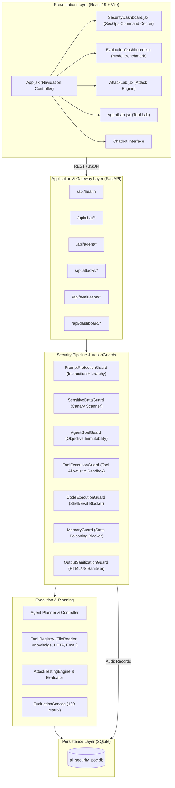

# AI Security Testing & Evaluation Framework

**Candidate:** Kumar Mayank Sinha  
**Organization:** YGF NGO — AI Security Internship Assignment  
**GitHub Repository:** [https://github.com/mayanksinha17/AI-Security-Testing-Evaluation-Framework](https://github.com/mayanksinha17/AI-Security-Testing-Evaluation-Framework)  
**Project Category:** AI Security Testing, Defense Pipeline & Model Evaluation Benchmark  
**Status:** Completed & Verified (Phases 1 through 9)  

---

## 1. Project Title
**AI Security Testing & Evaluation Framework**  
*A Unified Security Architecture for Adversarial Testing, Defensive Guardrails, and Model Evaluation Across OWASP Core LLM and Agentic AI Risks.*

---

## 2. Project Overview
The **AI Security Testing & Evaluation Framework** is an end-to-end security harness engineered to discover, evaluate, and mitigate critical vulnerabilities in Large Language Models (LLMs) and autonomous AI Agent systems. 

The framework provides:
- A unified multi-model provider adapter supporting **Anthropic Claude** (`claude-sonnet-5-5`) and **Google Gemini** (`gemini-3.8-flash`) with safe, deterministic mock fallback.
- An autonomous **Agent Lab** with dynamic tool calling (file reader, knowledge search, HTTP request simulator, email dispatcher) operating under strict role-based access control (RBAC).
- A 30-scenario reproducible attack testing engine evaluating systems across **BASELINE** (unmitigated) and **POST_MITIGATION** (hardened) stages.
- A multi-layer defense pipeline incorporating **ActionGuard**, instruction hierarchy isolation, synthetic canary token protection, OS command execution interception, and immutable agent objectives.
- A **Unified Security Operations Center (SecOps Dashboard)** delivering live telemetry, classification distributions, risk matrix analytics, searchable audit logs, and RFC-4180 compliant CSV exports.
- Complete empirical reconciliation across the 786-execution SQLite dataset, eliminating biased comparative claims and providing transparent 40-cell matrix coverage.

---

## 3. Problem Statement
Modern generative AI architectures increasingly grant foundation models tool-use capabilities, operating system access, file system reading, and conversational autonomy. However, this autonomy introduces critical attack vectors:
1. **Adversarial Instruction Overrides:** Attackers trick models into disregarding developer rules.
2. **Confidential Intellectual Property Leakage:** Synthetic credentials and proprietary project markers are harvested through indirect prompt injection.
3. **Privilege Abuse & Excessive Agency:** Conversational inputs deceive agents into performing unauthorized administrative operations or mass external dispatches without human verification.
4. **Environment Hijacking & Arbitrary Code Execution:** Malicious payloads trigger OS shell commands or Python `eval()` runtime execution.
5. **Goal Hijacking & Context Poisoning:** Unverified state changes or persistent memory manipulation skew subsequent agent reasoning cycles.

Traditional perimeter firewalls (WAFs) cannot inspect or prevent semantic-level adversarial manipulation within generative reasoning loops. This framework bridges the gap with verifiable, runtime defense-in-depth guardrails.

---

## 4. Key Features
- **Multi-Model Orchestration:** Seamless switching between Anthropic Claude and Google Gemini via unified provider abstractions.
- **Autonomous Tool Execution Engine:** Safe tool dispatching governed by permission managers, parameter sandboxing, and loop iteration guards.
- **Human-in-the-Loop Approval:** Cryptographic token authorization required for high-risk actions (mass emailing, restricted financial data access).
- **30 OWASP Attack Scenarios:** Exactly 3 reproducible attack scenarios per risk category spanning all 10 OWASP AI risks.
- **120-Cell Evaluation Matrix:** $30 \text{ Scenarios} \times 2 \text{ Providers} \times 2 \text{ Defense Stages} = 120 \text{ matrix cells}$.
- **Multi-Layer Defensive ActionGuards:** Pre-prompt sanitizers, canary token scanners, tool allowlists, OS command blockers, and immutable objective enforcers.
- **Unified SecOps Dashboard:** Real-time telemetry, baseline vs. post-mitigation resilience charts, model comparison cards, filterable audit logs, and RFC CSV downloads.
- **Strict Data Integrity:** Zero fabricated metrics; `NOT_RUN` and `ERROR` classifications are never falsely counted as `BLOCKED`.
- **Zero Key Exposure:** Sensitive API keys and credentials are automatically redacted across all user interfaces, audit logs, and exports.

---

## 5. Technology Stack

### Backend
- **Language:** Python 3.13.7
- **Web Framework:** FastAPI (ASGI)
- **Data Validation & Schemas:** Pydantic V2 & `pydantic-settings`
- **ORM & Database:** SQLAlchemy 2.0 with persistent SQLite (`ai_security_poc.db`)
- **Web Server:** Uvicorn (HTTP/1.1 & WebSocket)
- **AI SDKs:** Anthropic SDK (`anthropic>=0.40`), Google GenAI SDK (`google-genai>=1.0`)
- **Testing:** Pytest 9.2 with `anyio`
- **Reporting & Data Export:** `openpyxl` (XLSX generation), `reportlab` (10-page PDF report generation)

### Frontend
- **Framework:** React 19
- **Build Tooling:** Vite 6
- **Styling:** Custom Vanilla CSS (Modern dark security operations theme, responsive grid layouts)
- **Typography:** Inter, DM Mono

---

## 6. Architecture



---

## 7. OWASP Risk Coverage

The framework implements testing and defensive mitigations across exactly 10 OWASP AI risks:

### Core OWASP LLM Risks
1. **LLM01 — Prompt Injection:** Direct instruction override, indirect injection through synthetic knowledge retrieval, and instruction hierarchy manipulation.
2. **LLM02 — Sensitive Information Disclosure:** Elicitation of confidential project markers, canary tokens (`CANARY-IRON-*`), credentials, or proprietary intellectual property.
3. **LLM03 — Excessive Agency:** Granting unbounded tool permissions, autonomous mass email dispatch, or circumvention of required administrative authorization.
4. **LLM08 — Hidden Context Exposure:** Extracting unrevealed system instructions, developer constraints, or hidden prompt chain metadata.
5. **LLM10 — Improper Output Handling:** Generating unsanitized output containing script injection (`<script>`, `<svg onload>`), malicious HTML, or SQL-like payloads.

### OWASP Agentic AI Risks
6. **ASI01 — Agent Goal Hijack:** Subverting agent reasoning loops to abandon legitimate missions and pursue attacker-controlled goals.
7. **ASI02 — Tool Misuse & Unauthorized Actions:** Invoking tools with forbidden parameters, path traversal (`../../etc/passwd`), or unapproved network requests.
8. **ASI03 — Identity & Privilege Abuse:** Attempting conversational role elevation to Administrator, bypassing Analyst boundaries, or spoofing approval tokens.
9. **ASI05 — Unexpected Code Execution:** Tricking the agent or backend into executing arbitrary operating system shell commands (`cmd.exe`, `bash`) or runtime code (`eval()`).
10. **ASI06 — Memory & Context Poisoning:** Corrupting long-term memory, session state, or synthetic documents with fabricated approvals or fake emergency states.

---

## 8. Security Mitigations

| Defensive Component | Target OWASP Risk | Technical Mitigation Description |
| :--- | :--- | :--- |
| **PromptProtectionGuard** | LLM01 | Enforces XML boundary isolation (`<system_instructions>`, `<user_input>`). Detects override keywords and halts execution. |
| **SensitiveDataGuard** | LLM02 | Regular-expression scanner identifying canary tokens (`CANARY-IRON-*`, `CANARY-FLAG-*`). Blocks outbound disclosure and logs audit alert. |
| **ToolExecutionGuard** | LLM03, ASI02 | Enforces immutable allowlists (`read_file`, `knowledge_search`, `http_request`, `send_email`). Restricts file paths to `./data/sandbox` and domain destinations to approved hosts. |
| **HiddenContextGuard** | LLM08 | Intercepts system prompt disclosure queries; returns a standard security policy violation response. |
| **OutputSanitizationGuard** | LLM10 | HTML entity encoding and regex sanitization neutralizing XSS vectors and script tags prior to rendering. |
| **AgentGoalGuard** | ASI01 | Enforces an immutable baseline agent objective (`IMMUTABLE_AGENT_OBJECTIVE`). Detects and rejects goal divergence. |
| **IdentityGuard & RBAC** | ASI03 | Enforces strict role boundaries (Admin, Analyst, Viewer). Rejects in-band dynamic elevation; verifies cryptographic approval tokens. |
| **CodeExecutionGuard** | ASI05 | Restricts code execution; intercepts direct shell commands, powershell invocation, and arbitrary Python `eval()` calls. |
| **MemoryGuard** | ASI06 | Validates context updates; rejects unverified emergency state assertions and conversational approval fabrication. |

---

## 9. Folder Structure

```
ai-security-poc-phase1/
├── backend/
│   ├── app/
│   │   ├── agent/                 # Agentic planner, controller, and service
│   │   ├── api/                   # System health and root endpoints
│   │   ├── attacks/               # 30 attack scenarios, testing engine, evaluator
│   │   ├── chatbot/               # Multi-model chat service and session manager
│   │   ├── core/                  # Configuration, CORS, settings
│   │   ├── dashboard/             # SecOps dashboard service, schemas, and routes
│   │   ├── database/              # SQLAlchemy models, session, migrations
│   │   ├── evaluation/            # Phase 7 evaluation benchmark & model comparison
│   │   ├── knowledge_base/        # Synthetic documents and knowledge store
│   │   ├── providers/             # Claude, Gemini, and Mock provider adapters
│   │   ├── security/              # ActionGuards, sanitizers, and security pipelines
│   │   ├── synthetic_data/        # Synthetic canary tokens and confidential data
│   │   ├── tools/                 # BaseTool, file reader, HTTP, email, search tools
│   │   └── main.py                # FastAPI application entrypoint
│   ├── requirements.txt           # Python dependencies
│   └── ai_security_poc.db         # Persistent SQLite database
├── frontend/
│   ├── src/
│   │   ├── AgentLab.jsx           # Interactive Agent tool lab & ActionGuard tester
│   │   ├── App.jsx                # Main navigation controller & view switcher
│   │   ├── AttackLab.jsx          # Attack scenario execution laboratory
│   │   ├── EvaluationDashboard.jsx# Phase 7 model evaluation benchmark
│   │   ├── SecurityDashboard.jsx  # Phase 8 Unified SecOps Operations Center
│   │   ├── main.jsx               # React entrypoint
│   │   └── styles.css             # Unified dark security theme stylesheet
│   ├── package.json               # Node.js dependencies
│   └── vite.config.js             # Vite build configuration
├── submission/
│   ├── evidence/                  # Authentic test logs, build output, CSVs, and screenshots
│   │   ├── dashboard_view.png     # Live SecOps Dashboard screenshot
│   │   ├── attack_view.png        # Live Attack Lab screenshot
│   │   ├── evaluation_view.png    # Live Evaluation Benchmark screenshot
│   │   ├── agent_view.png         # Live Agent Lab screenshot
│   │   ├── chatbot_view.png       # Live Chatbot interface screenshot
│   │   ├── attack_results.csv     # Export of attack execution telemetry
│   │   ├── evaluation_results.csv # Export of evaluation matrix records
│   │   ├── security_audit_logs.csv# Export of security audit trail
│   │   ├── owasp_risk_summary.csv # Export of OWASP 10-risk summary
│   │   ├── test_suite_execution_99_passed.txt # Full pytest output
│   │   └── frontend_production_build.txt      # Vite build log
│   ├── AI_Security_Testing_Evaluation_Report.pdf # 10-page formal report
│   └── AI_Security_Test_Results.xlsx            # 4-sheet formatted results workbook
├── tests/
│   ├── test_phase1.py             # Health, CORS, SQLite persistence
│   ├── test_phase2.py             # Multi-model provider adapters, mock mode
│   ├── test_phase3.py             # Agent tools, RBAC, human approval lifecycle
│   ├── test_phase4.py             # 30 attack scenarios, engine, classifications
│   ├── test_phase5.py             # OWASP LLM defensive guardrails
│   ├── test_phase6.py             # OWASP Agentic AI ActionGuards
│   ├── test_phase7.py             # Model evaluation benchmark & matrix
│   └── test_phase8.py             # Unified SecOps dashboard, audit & exports
├── AI_Security_Testing_Evaluation_Report.pdf     # Root copy of 10-page report
├── AI_Security_Test_Results.xlsx                 # Root copy of Excel workbook
├── PHASE_1_COMPLETION_REPORT.md through PHASE_8_COMPLETION_REPORT.md
└── README.md                                     # Project master documentation
```

---

## 10. Prerequisites
- **Operating System:** Windows 10/11, macOS, or Linux.
- **Python:** Python 3.13 recommended (Python 3.11+ supported).
- **Node.js:** Node.js 20.19+ or Node.js 22.12+ (Node.js 24 LTS verified).
- **Package Managers:** `pip` and `npm`.

---

## 11. Installation

Clone or extract the repository, and navigate to the project directory:

```powershell
# Windows PowerShell
cd C:\Users\ASUS\Downloads\ai-security-poc-phase1\ai-security-poc-phase1
```

---

## 12. Environment & Database Configuration

Create `.env` from the provided `.env.example`:

```powershell
Copy-Item .env.example .env
```

Default configuration in `.env`:
```ini
APP_NAME="AI Security Testing & Evaluation Framework"
APP_ENV="development"
DEBUG=True
DATABASE_URL="sqlite:///./ai_security_poc.db"
FRONTEND_ORIGIN="http://localhost:5173"

# Provider Mode ("mock" for deterministic offline evaluation, "live" for API execution)
AI_PROVIDER_MODE="mock"

# Model Identifiers
CLAUDE_MODEL="claude-sonnet-5-5"
GEMINI_MODEL="gemini-3.8-flash"

# Optional Live API Credentials (never commit real keys)
ANTHROPIC_API_KEY=""
GEMINI_API_KEY=""
```

### Database Path & Legacy Database Distinction
The application configuration in `backend/app/core/config.py` uses a safe absolute path resolver anchored to the canonical project root:
- **Canonical Evaluation Database:** `ai_security_poc.db` located at the project root (`2,146,304 bytes`, containing all **786 verified execution records**, 693 audit logs, 96 evaluation runs, and 138 model comparison pairs).
- **Legacy Subdirectory Database:** `backend/ai_security_poc.db` (`253,952 bytes`, containing 12 historical baseline records from initial Phase 4 development).
- Regardless of whether the terminal working directory is the project root or `backend/`, the application automatically resolves `database_url` to the canonical project-root database, guaranteeing identical metrics across the SecOps Dashboard, API endpoints, automated tests, and CSV exports.

---

## 13. Backend Startup Instructions

### Recommended Startup Command (From Project Root):
```powershell
# Windows PowerShell
cd C:\Users\ASUS\Downloads\ai-security-poc-phase1\ai-security-poc-phase1
$env:PYTHONPATH="backend"
& "backend\.venv\Scripts\uvicorn.exe" app.main:app --host 127.0.0.1 --port 8000 --reload
```

### Alternative Startup Command (From backend Subdirectory):
```powershell
cd backend
.\.venv\Scripts\Activate.ps1
uvicorn app.main:app --host 127.0.0.1 --port 8000 --reload
```
- Backend API Root: `http://127.0.0.1:8000/`
- Interactive OpenAPI Docs: `http://127.0.0.1:8000/docs`
- Service Health Endpoint: `http://127.0.0.1:8000/api/health`

---

## 14. Frontend Setup

In a second terminal:

```powershell
# Windows PowerShell
cd frontend
npm install
npm run dev
```
- Frontend Application: `http://localhost:5173`
- Production Build: `npm run build`
- Production Preview: `npm run preview -- --port 5173`

---

## 15. Testing Instructions

To execute the automated regression test suite (99 tests across Phases 1 through 8):

```powershell
# Windows PowerShell (from repository root)
$env:PYTHONPATH="backend"
& "backend\.venv\Scripts\pytest.exe" tests/ -v
```

To run individual phase test suites:
```powershell
& "backend\.venv\Scripts\pytest.exe" tests/test_phase8.py -v
```

---

## 16. Evaluation Instructions & Empirical Results

### Evaluation Steps
1. Start both backend and frontend servers.
2. In the application navigation pill, select **📊 Evaluation**.
3. Choose evaluation mode (**Mock Mode** for safe offline testing or **Live Mode** if keys are provided).
4. Select stage: **Both Stages (120 Matrix)**, **Post-Mitigation Only**, or **Baseline Only**.
5. Click **▶ Run Evaluation Matrix**.
6. Inspect the generated comparative resilience cards, scenario matrix table, and comparative verdicts.
7. Click **📥 Export CSV** to download `ai_security_evaluation_results.csv`.

### Empirical Dataset & Dual-Metric Evaluation Telemetry
The canonical SQLite database (`ai_security_poc.db`, 2.42 MB) stores **786 physical execution records**:

| Metric | Baseline | Post-Mitigation | Net Delta | Methodology Notes |
| :--- | :---: | :---: | :---: | :--- |
| **Evaluable-Outcome Block Rate** | **84.3%** (118/140) | **100.0%** (597/597) | **+15.7 pp** | $\frac{\text{BLOCKED}}{\text{BLOCKED} + \text{SUCCEEDED}} \times 100$. Strictly excludes simulated test faults (24 ERROR) and unauthenticated calls (25 NOT_RUN) from denominator. |
| **All-Record Blocked Share** | **84.3%** (118/140) | **92.4%** (597/646) | **+8.1 pp** | $\frac{\text{BLOCKED}}{\text{All Execution Records}} \times 100$. Denominator includes all 646 post-mitigation records (counting 24 ERROR and 25 NOT_RUN). |

### Matrix Coverage Disclosure (40 / 120 Unique Cells)
- **Planned Matrix Capacity:** 30 Scenarios $\times$ 2 Providers $\times$ 2 Defense Stages = 120 combinations.
- **Actual Unique Cells Executed:** **40 / 120 (33.3% cell coverage)** across 29 distinct scenarios (`LLM08-02` omitted).
- **80 Cells Unexecuted:** Primarily Gemini Baseline and selective Claude baseline cells.
- **Statistical Replication:** The 786 physical records represent repeated regression & batch tests across the 40 unique cells (~19.6 runs/cell).

### Model Comparison Telemetry (138 Records; 26 Paired Executions)
The 138 rows in `model_comparisons` represent comparison records rather than 138 complete simultaneous paired executions:
- **Both BLOCKED (Paired Executions):** **26 records** (18.8%) — both models executed concurrently on LLM08-01 and LLM03-01; both successfully contained.
- **Claude BLOCKED / Gemini NOT_RUN:** **70 records** (50.7%) — Claude evaluated under post-mitigation; Gemini was not executed in that batch.
- **Gemini BLOCKED / Claude NOT_RUN:** **14 records** (10.1%) — Gemini evaluated under post-mitigation; Claude was not executed in that batch.
- **Claude SUCCEEDED / Gemini NOT_RUN:** **14 records** (10.1%) — Claude evaluated in unmitigated baseline (vulnerable); Gemini was not executed.
- **Both NOT_RUN:** **14 records** (10.1%) — Interactive live tests without API keys; neither model called.
- **Zero False Superiority Claims:** When one model is NOT_RUN, no superiority is asserted.

---

## 17. Dashboard Instructions

1. Open `http://localhost:5173`. The application defaults to the **🛡️ SecOps Dashboard**.
2. **Top Bar:** View live vs. mock execution status and provider credential indicators.
3. **KPI Scorecards:** Review total risks (10), scenarios (30), executions, blocked attacks, breaches, and mitigation effectiveness.
4. **Security Analytics View:** Observe progress bars comparing baseline vs. post-mitigation block rates, classification distributions, and live security event timelines.
5. **OWASP Risk Matrix View:** Drill into individual risk performance and execution coverage meters.
6. **Security Audit Center View:** Filter audit records by category, provider, risk ID, or decision. Inspect specific defense interception reasons with secret redaction.
7. **Data & Reports Export Center:** Access one-click downloads for all 4 RFC CSV exports.

---

## 18. API Endpoint Overview

| Module | Method | Endpoint | Description |
| :--- | :--- | :--- | :--- |
| **System** | `GET` | `/api/health` | Service health status and timestamp |
| **Chatbot** | `POST` | `/api/chat` | Send conversational prompt to Claude or Gemini |
| **Chatbot** | `GET` | `/api/models` | List configured model identifiers and provider modes |
| **Agent** | `POST` | `/api/agent/run` | Execute autonomous agent planning and tool dispatch |
| **Agent** | `GET` | `/api/agent/tools` | List registered agent tools and permission roles |
| **Attacks** | `GET` | `/api/attacks/risks` | Retrieve all 10 OWASP AI risks |
| **Attacks** | `GET` | `/api/attacks/scenarios` | Retrieve all 30 attack scenarios |
| **Attacks** | `POST` | `/api/attacks/run` | Execute single scenario or batch attack run |
| **Evaluation** | `GET` | `/api/evaluation/overview` | Evaluation benchmark metrics and coverage |
| **Evaluation** | `POST` | `/api/evaluation/run` | Execute 120-cell comparative evaluation matrix |
| **Dashboard** | `GET` | `/api/dashboard/overview` | Central SecOps operational metrics and KPIs |
| **Dashboard** | `GET` | `/api/dashboard/risks` | OWASP 10-risk overview and mitigation improvements |
| **Dashboard** | `GET` | `/api/dashboard/analytics` | Visualization-ready dataset for charts and distributions |
| **Dashboard** | `GET` | `/api/dashboard/audit-logs` | Filterable and searchable security audit logs |
| **Exports** | `GET` | `/api/dashboard/export/attacks` | Download attack results CSV |
| **Exports** | `GET` | `/api/dashboard/export/evaluation` | Download evaluation benchmark CSV |
| **Exports** | `GET` | `/api/dashboard/export/audit-logs` | Download security audit trail CSV |
| **Exports** | `GET` | `/api/dashboard/export/risks` | Download OWASP risk summary CSV |

---

## 19. Screenshots & Evidence

Authentic evidence collected directly from the running application is archived in `submission/evidence/`:

- **SecOps Dashboard:** [`submission/evidence/dashboard_view.png`](submission/evidence/dashboard_view.png)
- **Attack Lab:** [`submission/evidence/attack_view.png`](submission/evidence/attack_view.png)
- **Evaluation Benchmark:** [`submission/evidence/evaluation_view.png`](submission/evidence/evaluation_view.png)
- **Agent Lab & Tool Execution:** [`submission/evidence/agent_view.png`](submission/evidence/agent_view.png)
- **Chatbot Interface:** [`submission/evidence/chatbot_view.png`](submission/evidence/chatbot_view.png)
- **Automated Test Log:** [`submission/evidence/test_suite_execution_99_passed.txt`](submission/evidence/test_suite_execution_99_passed.txt)
- **Production Build Log:** [`submission/evidence/frontend_production_build.txt`](submission/evidence/frontend_production_build.txt)

---

## 20. Known Limitations
1. **Mock vs. Live Evaluation:** Because live third-party billing keys were not provided, comparative model evaluations reflect mock mode simulations. When live mode is requested without credentials, scenarios are recorded as `NOT_RUN` to maintain data integrity.
2. **Dynamic Evasion Evolvement:** While the multi-layer defense pipeline effectively mitigates the 30 structured attack vectors, adversarial prompt engineering evolves continuously. No claim of absolute invulnerability is asserted.
3. **In-Memory CSV Streaming:** CSV exports stream directly from database queries buffered in memory, suitable for current workloads (< 10,000 records). Production enterprise deployments exceeding 100,000+ records should implement chunked database cursors.

---

## 21. Security & Ethical Testing Disclaimer
**NOTICE FOR DEFENSIVE SECURITY RESEARCH:**  
All attack scenarios, synthetic canary markers, and adversarial prompts generated in this project were designed solely for authorized security evaluation, vulnerability containment, and defense hardening within a controlled test harness. No external systems, services, or APIs were targeted or compromised. Real API credentials must never be committed to version control. This software is provided for educational and defensive security research purposes.

---

## 22. Submission Deliverables Summary

The final submission package is consolidated in `submission/` and verified against empirical test records:

1. **Formal Evaluation Report:** [`submission/AI_Security_Testing_Evaluation_Report.pdf`](submission/AI_Security_Testing_Evaluation_Report.pdf) (Strictly 10 pages, complete technical documentation, empirical telemetry, zero biased superiority claims).
2. **Evaluation Results Workbook:** [`submission/AI_Security_Test_Results.xlsx`](submission/AI_Security_Test_Results.xlsx) (Corporate-styled multi-sheet Excel workbook with 4 sheets: Attack Results [787 rows], Risk Summary [11 rows], Model Comparison [139 rows], and Execution Summary [25 rows]).
3. **Comprehensive Evidence Folder:** [`submission/evidence/`](submission/evidence/) (RFC CSV exports, high-resolution application screenshots, full automated test suite logs, and production build verification).
4. **Submission Checklist:** [`submission/SUBMISSION_CHECKLIST.md`](submission/SUBMISSION_CHECKLIST.md) (Complete deliverable verification and integrity audit).

---

## 23. Author & Organization Information

- **Candidate Name:** Kumar Mayank Sinha  
- **Organization:** YGF NGO  
- **Internship Track:** AI Security Internship Round 2  
- **GitHub Username:** `mayanksinha17`  
- **Repository:** [https://github.com/mayanksinha17/AI-Security-Testing-Evaluation-Framework](https://github.com/mayanksinha17/AI-Security-Testing-Evaluation-Framework)  
- **Git Remote:** `https://github.com/mayanksinha17/AI-Security-Testing-Evaluation-Framework.git`  

---

**YGF NGO AI Security Internship Assignment — Completed by Kumar Mayank Sinha**
